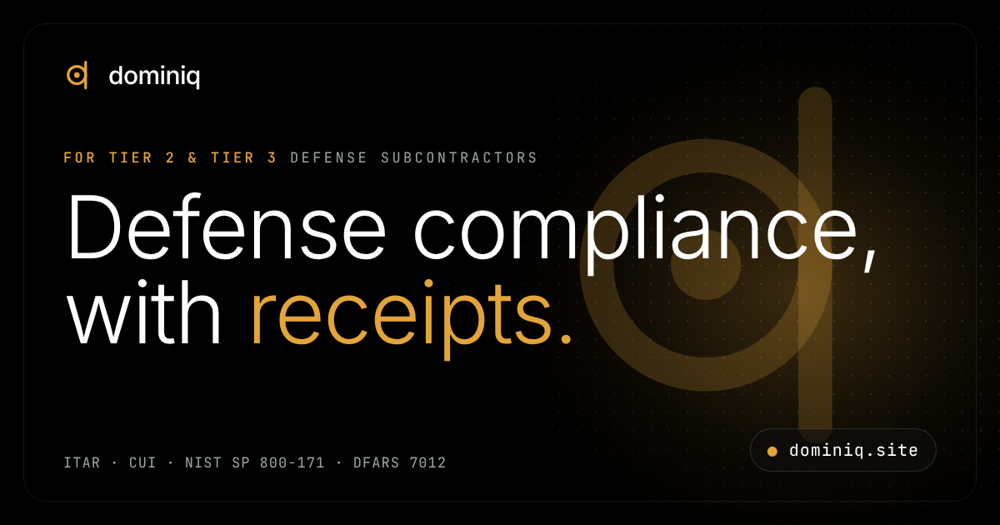

[](https://dominiq.site)

# Dominiq

**Defense compliance, with receipts.**

AI compliance software for Tier 2 and Tier 3 defense subcontractors. Dominiq classifies ITAR and CUI files, maps evidence to all 110 NIST SP 800-171 requirements, and vets suppliers against the clauses you flow down to them.

[](https://dominiq.site)


**[Website](https://dominiq.site)** · **[Book a demo](mailto:team@dominiq.site?subject=Dominiq%20demo%20request)** · **[Founder on LinkedIn](https://www.linkedin.com/in/shriman-maheshwari-195abb32a/)**

---

## Contents

- [The problem](#the-problem)
- [Who it is for](#who-it-is-for)
- [How it works](#how-it-works)
- [Capabilities](#capabilities)
- [What Dominiq produces](#what-dominiq-produces)
- [Data handling](#data-handling)
- [Founder](#founder)
- [Get in touch](#get-in-touch)
- [About this repository](#about-this-repository)
- [Sources](#sources)

---

## The problem

A forty-person machine shop answers to the same 110 security requirements as its prime — and too often proves it with a shared drive, a spreadsheet and a signature nobody is fully sure they can stand behind.

### By the numbers

| | Figure | What it means | Source |
|---|---|---|---|
| Requirements to evidence | **110** | NIST SP 800-171 Rev 2, the CMMC Level 2 baseline. Level 1 covers 15 basic safeguards for FCI. | [2] |
| To report a cyber incident | **72 hours** | From discovery, under DFARS 252.204-7012 — which also requires NIST SP 800-171 and flows down to subcontracts. | [5] |
| One FCA settlement, Sep 2026 | **$2,042,518** | Honeywell Aerospace, over alleged NIST SP 800-171 gaps on one of its networks. | [6] |
| ITAR civil penalty | **$1,271,078** | Per violation, or twice the transaction value if greater, after the 2025 inflation adjustment to 22 CFR 127.10. | [7] |
| Assessment capacity | **103** | Authorized C3PAOs in March 2026, while at least 80,000 companies are expected to need Level 2 certification. | [8] |

> **Status, 3 November 2026.** CMMC Phase 2 third-party certification has been suspended since 13 July 2026, with restart options under review. Phase 1 self-assessments and annual SPRS affirmations remain in force, as they have since 10 November 2025. [1] [3] [4] [9]
>
> The audit was paused. The obligation wasn't.

---

## Who it is for

The operations manager or office lead at a small defense manufacturer — a machine shop, electronics builder or specialty supplier — who owns the SPRS score without a dedicated compliance department.

---

## How it works

1. **Connect where the files already live.** Read-only connectors for SharePoint, OneDrive, shop file servers and mailboxes. Nothing is moved, so your CUI boundary stays exactly where your assessor expects it.
2. **Classify every file, then follow it.** Export legends, distribution statements, title blocks and CUI banners are read in context. Low-confidence calls go to a human review queue — never straight into your SSP.
3. **Map evidence to all 110 requirements.** Every requirement links to the file, log or policy that proves it, scored with the DoD Assessment Methodology — so the number you affirm in SPRS comes with receipts.

### What it looks like

*Illustrative example — sample data, not a real customer.*

```text
YOU   Our prime just flowed DFARS 252.204-7012 down on PO 4471. Find every drawing
      with ITAR markings, tell me who opened them in the last 90 days, and draft
      evidence for 3.1.1 and 3.1.3.

@Classifier       Read 2,847 files across SharePoint and the shop file server.
                  38 carry ITAR export legends, 214 hold CUI, 19 sent to human review.

@AccessTrace      Pulled 90 days of access logs on the 38 files. 3 were emailed to a
                  personal Gmail account — flagged against 3.1.3.

@ControlMapper    3.1.1 (limit access to authorized users) is met. 3.1.3 (control the
                  flow of CUI) is not met until the mail path is closed — POA&M-eligible.

@EvidenceWriter   Drafted SSP text for both requirements, one POA&M item with a 180-day
                  closeout date, and a summary for your affirming official.

✓ Evidence pack ready — 2 requirements documented, 1 finding awaiting human sign-off · 41 s
```

---

## Capabilities

| Module | What it does |
|---|---|
| **Document control** | Ask about any file, folder or person in plain English. Dominiq answers with who can open it, how it is marked and what that access means under ITAR — then drafts the fix for a human to approve. |
| **Supplier vetting** | Send flow-down questionnaires, collect SPRS scores and affirmations, and see which sub-tier vendor touches your CUI without DFARS 252.204-7012 in its paperwork. |
| **Monitoring** | When CUI leaves its boundary, Dominiq starts the DFARS 252.204-7012 reporting clock and lays out the steps: contain, preserve images for at least 90 days, and report through DIBNet. |

---

## What Dominiq produces

- An SPRS estimate, scored line by line and tied to evidence for each of the 110 requirements
- A System Security Plan and POA&M, with every open item tracked against the 180-day closeout window [1]
- An inventory of every ITAR and CUI file: where it lives, how it is marked and who has opened it
- A flow-down ledger of your suppliers: which clauses they received and what they affirmed

---

## Data handling

Under ITAR, releasing technical data to a non-U.S. person is an export. Dominiq is designed to run inside your own Microsoft 365 GCC High or Azure Government tenant through read-only connectors, so files are not copied out and the Dominiq team does not need access to them.

Dominiq is pre-launch, so this describes the intended architecture, not a certification. Dominiq does not issue CMMC certifications and is not legal or export-control advice.

---

## Founder

**Shriman Maheshwari** — Founder & CEO · [LinkedIn](https://www.linkedin.com/in/shriman-maheshwari-195abb32a/)

Shriman grew up inside his family's B2B electrical distribution business and took on its operational side at 17 — working through documents, cleaning data and building spreadsheet cases for decisions, by hand. The ceiling on that manual work is what pulled him toward AI systems.

He studies Computer Science at BITS Pilani, Goa, on a dual-degree track with CentraleSupélec (Université Paris-Saclay), specializing in AI. Dominiq is his bet that the smallest suppliers in the defense chain deserve evidence tooling as good as the primes they build for.

> "A supplier shouldn't lose a program because the proof was scattered across three drives and someone's inbox."

---

## Get in touch

Dominiq is pre-launch. Demos and early access are by email.

- **Book a demo:** [team@dominiq.site](mailto:team@dominiq.site?subject=Dominiq%20demo%20request)
- **Website:** [dominiq.site](https://dominiq.site)
- **Founder:** [Shriman Maheshwari on LinkedIn](https://www.linkedin.com/in/shriman-maheshwari-195abb32a/)
- **Security reports:** see [.well-known/security.txt](.well-known/security.txt)

---

## About this repository

This repository is the source of [dominiq.site](https://dominiq.site): a one-page static site served by GitHub Pages. There is no build step. `index.html` holds the markup, CSS, JavaScript and structured data in a single file; the only external requests are Google Fonts and Unsplash photos.

### Files

```text
.
├── index.html               The whole site: markup, CSS, JS and JSON-LD
├── 404.html                 Not-found page in the same design
├── og-image.png             1200 × 630 social preview card
├── favicon.svg              Logo mark, vector
├── favicon-32.png           Browser tab icon
├── apple-touch-icon.png     180 × 180 home-screen icon
├── icon-192.png             Web app icon
├── icon-512.png             Web app icon and schema logo
├── site.webmanifest         Web app manifest
├── robots.txt               Crawl rules and sitemap location
├── sitemap.xml              Homepage and image entry
├── llms.txt                 Plain-language summary for AI search tools
├── humans.txt               Team and site credits
├── .well-known/
│   └── security.txt         Security contact (expires 2027-11-03)
├── CNAME                    Custom domain: dominiq.site
├── .nojekyll                Stops Jekyll so .well-known is published
└── README.md
```

### Page structure

Hero with an animated product demo → The problem (sourced figures and a dated status line) → How it works → Capabilities → Founder → FAQ → Footer with numbered sources.

### Run locally

From the repository root:

```bash
python3 -m http.server 8000
```

Then open `http://localhost:8000`. Use a local server rather than opening the file directly, because the icons, manifest and 404 page use root-relative paths.

### Deploy to GitHub Pages

1. Push these files to the root of the repository's default branch.
2. In **Settings → Pages**, set the source to **Deploy from a branch**, then choose the default branch and the `/ (root)` folder.
3. The `CNAME` file already sets the custom domain to `dominiq.site`.
4. Add these DNS records at your registrar:

| Type | Host | Value |
|---|---|---|
| A | @ | 185.199.108.153 |
| A | @ | 185.199.109.153 |
| A | @ | 185.199.110.153 |
| A | @ | 185.199.111.153 |
| AAAA | @ | 2606:50c0:8000::153 |
| AAAA | @ | 2606:50c0:8001::153 |
| AAAA | @ | 2606:50c0:8002::153 |
| AAAA | @ | 2606:50c0:8003::153 |
| CNAME | www | YOUR-GITHUB-USERNAME.github.io |

5. Verify the domain in your GitHub account settings (GitHub recommends this to prevent domain takeovers), then tick **Enforce HTTPS**. The option can take up to 24 hours to appear. [10]

### Keep it accurate

- [ ] When the CMMC status changes, update the dated status line in the Problem section, the FAQ answer to "CMMC Phase 2 is paused. Do we still need this?", and `llms.txt`.
- [ ] The FAQ is written twice in `index.html`: the visible `details` blocks and the `FAQPage` JSON-LD. Edit both, word for word.
- [ ] Every statistic needs a numbered entry in the footer's Sources list. Example data stays labelled *Illustrative*.
- [ ] After content changes, update `dateModified` in the JSON-LD and `lastmod` in `sitemap.xml`.
- [ ] Renew `.well-known/security.txt` before it expires on 2027-11-03.
- [ ] Self-host the seven Unsplash photos before production; they are currently hotlinked.
- [ ] Replace the "SM" monogram in the founder card with a real headshot.

### SEO and discovery

- Title, meta description, canonical URL, robots, Open Graph and Twitter large-image card
- JSON-LD graph: `Organization`, `Person`, `WebSite`, `WebPage`, `SoftwareApplication` and `FAQPage`
- `sitemap.xml`, `robots.txt`, `llms.txt`, `humans.txt`, `security.txt` and a web app manifest
- Lighthouse: 100 for accessibility and 100 for SEO, on desktop and mobile

### Design system

- **Colour:** black background, translucent glass surfaces, brass accent `#E3A43A` with hover `#F7C35E`, text `#FFFFFF` and grey `#9BA6A3`
- **Type:** Inter (300–600) for headlines and body; JetBrains Mono for labels, logs and data
- **Logo:** a ring with a long upright stroke, which reads as both the "d" and the "q" in dominiq
- **Motion:** scroll reveals and a sequential demo; respects reduced-motion settings and works without JavaScript

### Credits

Photography from [Unsplash](https://unsplash.com) (hero photo by Greg Rosenke). Typefaces: Inter and JetBrains Mono via Google Fonts.

---

## Sources

1. U.S. Department of War CIO — [CMMC 101 program overview](https://dodcio.defense.gov/Portals/0/Documents/CMMC/CMMC-101-Nov2025.pdf) (Nov 2025): phases from 10 Nov 2025; POA&M closeout within 180 days.
2. Federal Register — [CMMC Program final rule, 32 CFR Part 170](https://www.federalregister.gov/documents/2024/10/15/2024-22905/cybersecurity-maturity-model-certification-cmmc-program) (15 Oct 2024): Level 1, 15 requirements; Level 2, 110 requirements (NIST SP 800-171 Rev 2).
3. Federal Register — [DFARS Case 2019-D041 final rule](https://www.federalregister.gov/documents/2025/09/10/2025-17359/defense-federal-acquisition-regulation-supplement-assessing-contractor-implementation-of) (10 Sep 2025): effective 10 Nov 2025.
4. Steptoe — [Department of War Pauses CMMC Phase II Implementation](https://www.steptoe.com/en/news-publications/international-compliance-blog/department-of-war-pauses-cmmc-phase-ii-implementation-and-launches-60-day-program-review.html) (Jul 2026): suspension announced 13 Jul 2026; Phase 1 remains in effect.
5. Acquisition.gov — [DFARS 252.204-7012](https://www.acquisition.gov/dfars/252.204-7012-safeguarding-covered-defense-information-and-cyber-incident-reporting.): 72-hour reporting, FedRAMP Moderate–equivalent cloud, subcontract flow-down, 90-day image preservation.
6. U.S. Department of Justice — [Honeywell Aerospace False Claims Act settlement](https://justice.gov/opa/pr/honeywell-aerospace-inc-agrees-pay-over-2m-settle-false-claims-act-allegations-failing) (1 Sep 2026): $2,042,518.
7. Federal Register — [Department of State 2025 Civil Monetary Penalties Inflationary Adjustment](https://www.federalregister.gov/documents/2025/01/10/2025-00361/department-of-state-2025-civil-monetary-penalties-inflationary-adjustment) (10 Jan 2025): 22 CFR 127.10, $1,271,078.
8. Secureframe — [CMMC Ecosystem by the Numbers](https://secureframe.com/blog/cmmc-ecosystem) (Cyber AB marketplace data as of Mar 2026): 103 authorized C3PAOs; at least 80,000 organizations expected to need Level 2.
9. Federal News Network — [RFI offers path forward for DoD with CMMC](https://federalnewsnetwork.com/defense-main/2026/10/rfi-offers-path-forward-for-dod-with-cmmc/) (27 Oct 2026): Phase 2 restart options under discussion; NIST SP 800-171 remains a requirement.
10. GitHub Docs — [Managing a custom domain for your GitHub Pages site](https://docs.github.com/en/pages/configuring-a-custom-domain-for-your-github-pages-site/managing-a-custom-domain-for-your-github-pages-site): apex A and AAAA records, `www` CNAME, domain verification and HTTPS.

---

© 2026 Dominiq. All rights reserved. Dominiq is software that organizes compliance evidence; it is not legal or export-control advice.
